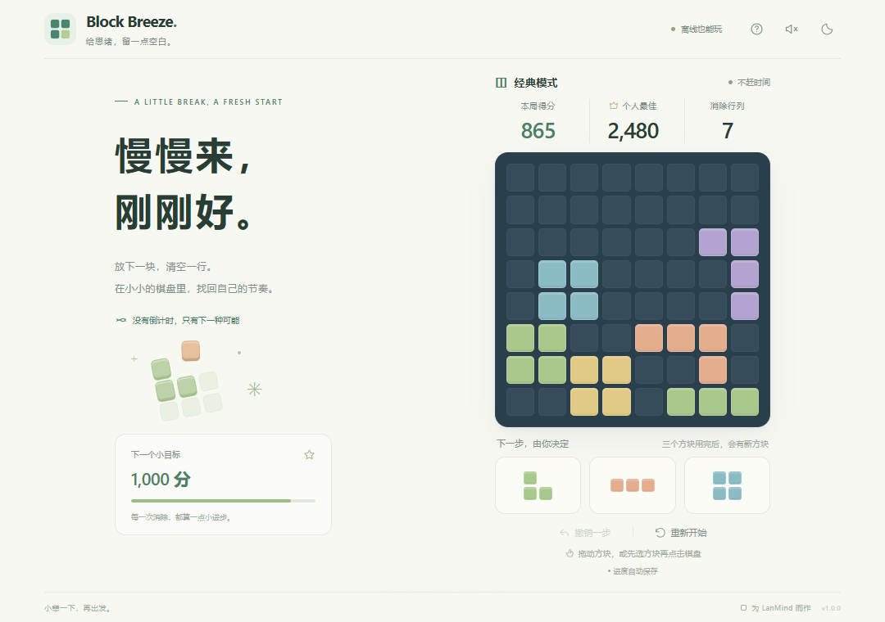

# Block Breeze · 方块小憩

**慢慢来，刚刚好。** 一个没有倒计时的离线方块消除小游戏，为 LanMind 而作，也可以在浏览器里独立试玩。



## 玩法

把三个待选方块放入 8 × 8 棋盘。横向或纵向填满一条即消除；三个方块用完后补充新的一组，剩余方块都无法放下时结束本局。

- 鼠标或触屏拖放；也可以先选方块，再点击棋盘。
- 键盘 `1` / `2` / `3` 选方块，方向键移动，`Enter` 放置，`Esc` 取消选择。
- 每放一格 +5 分；每消除一条 +100 分。连续几步消除会连击，倍率最高 ×5；同时消行和列额外 +50 分。
- 可以撤销最近一步，个人最佳保留；新开一局前会确认。
- 自动保存棋盘、待选方块、撤销记录和个人最佳。
- 浅色 / 深色主题，可选音效，跟随 LanMind 语言切换中英文。
- 零运行时依赖、零外部资源请求，不申请任务或文档访问权限。

## 安装到 LanMind

从 [GitHub Releases](https://github.com/bspeng922/lanmind-plugin-block-breeze/releases) 下载 `block-breeze-<版本>.lmpk`，进入 **系统设置 → 功能与插件 → 导入插件包**，选择下载的文件，再点击「打开」。要求 LanMind **0.2.1+**、网页插件 SDK 1。

新版宿主的导入窗口同时支持 `.zip`，可直接选择 Release 附件中的同名 ZIP，无需解压。旧版宿主使用 `.lmpk`。这两个文件是字节完全一致的签名插件包。

GitHub 的 **Code → Download ZIP** 和 Release 下自动生成的 **Source code (zip)** 是源码归档；里面含有源码仓库目录结构，不能直接作为插件安装。

## 本地试玩与验证

需要 Node.js 22+：

```sh
npm ci
npm run dev
```

打开 `http://127.0.0.1:5174`。开发服务器使用和宿主一致的内容安全策略，不依赖 Vite、CDN 或远程字体。

```sh
npm test
npx playwright install chromium
npm run test:browser
npm run build
```

构建结果位于 `dist/`，只包含清单、HTML、CSS、SVG 和独立 JavaScript 文件。可以用 `node scripts/serve.mjs --dist` 预览构建产物。浏览器试玩使用当前站点的 `localStorage`；进入 LanMind 后使用 `window.LanMind.storage`，由宿主按插件、工作区和用户隔离。宿主存档读取失败时不会覆盖旧进度，界面会提示本次进度无法保存。

## 生成插件安装包

首次为这个发布者创建一把 **Ed25519** 私钥，保存在仓库外。PowerShell 示例：

```powershell
npm.cmd run keygen -- --out "$env:USERPROFILE\.lanmind\plugin-keys\block-breeze.pem"
npm.cmd run package -- --key "$env:USERPROFILE\.lanmind\plugin-keys\block-breeze.pem"
npm.cmd run verify -- --input release/block-breeze-1.0.0.lmpk
```

`release/` 中生成：

| 文件 | 用途 |
| --- | --- |
| `block-breeze-<版本>.lmpk` | 兼容现有 LanMind 的签名安装包 |
| `block-breeze-<版本>.zip` | 同一签名安装包，供支持 ZIP 的导入窗口使用 |
| `SHA256SUMS.txt` | 两个安装包的 SHA-256 |
| `plugin-release.json` | 插件 ID、版本、发布者指纹、哈希、最低宿主版本和下载地址 |

包格式与 LanMind 内置打包器一致：`manifest.json` 列出资源哈希，`signature.json` 保存公钥与签名。签名对象为 `lanmind-web-plugin-v1\0` 与原始清单字节的拼接。打包可复现，已有输出不会被覆盖。

保管并备份这把私钥，后续发布继续使用它；更换私钥会被 LanMind 识别为另一个发布者。不要提交私钥或把它放进 `dist/`。

## 发布到 GitHub

仓库：[bspeng922/lanmind-plugin-block-breeze](https://github.com/bspeng922/lanmind-plugin-block-breeze)。此目录是独立 Git 仓库，父目录 `lanmind-plugins/` 仅用于容纳各插件。

1. 在仓库 **Settings → Secrets and variables → Actions** 中添加 `BLOCK_BREEZE_SIGNING_KEY`，内容为上面私钥文件的完整 PEM 文本。首次配置后持续沿用。
2. 更新 `package.json` 和 `manifest.json` 中的相同版本号，以及界面中的版本文案。
3. 推送代码和对应标签，例如 `v1.0.0`。

```sh
git push origin main
git tag v1.0.0
git push origin v1.0.0
```

CI 验证规则、存储、签名与浏览器交互。标签触发发布流程，自动生成 GitHub Release 并上传上述四个附件。相同版本发布后不再替换内容；修改后提升版本号。

## GitHub 下载导入的后续接入

当前已实现 **Release 插件包 → 下载 → 本地导入 → 使用**。宿主侧「粘贴 GitHub 链接自动下载并导入」尚未实现，推荐下一步按下面流程接入：

1. 接受仓库地址、Release 页面地址、`.lmpk` / 插件 `.zip` 附件地址；仓库地址解析到最新兼容 Release。
2. 下载 Release 插件附件，复用现有下载进度和取消功能。
3. 沿用现有包大小限制、签名、资源哈希、版本和兼容性校验，再交给现有安装流程。
4. 自动源码 ZIP 可提供明确引导，指向 Release 的插件附件。

网络下载由宿主负责，游戏本身保持完全离线。`plugin-release.json` 是本仓库的发布元数据，目前不代表宿主已支持新的远程目录协议。

## 目录

```text
block-breeze/
├── .github/          # CI 与签名发布流程
├── docs/             # 预览图
├── src/
│   ├── app.js        # 页面、鼠标 / 触屏 / 键盘交互
│   ├── engine.js     # 放置、消除、计分和可用位置判断
│   ├── i18n.js       # 中英文文案
│   └── storage.js    # 宿主 / 浏览器存储与串行保存
├── scripts/          # 本地预览、静态构建、签名打包
├── tests/            # 规则、存储、签名与浏览器测试
├── icon.svg
├── index.html
├── manifest.json
└── styles.css
```

MIT License.
